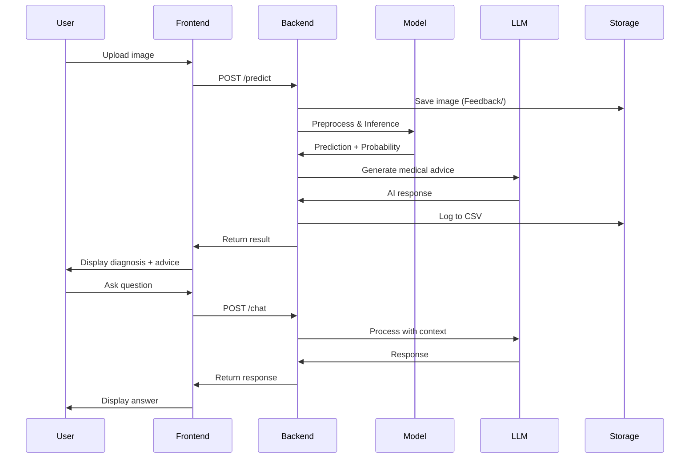

# SkinCare AI - Medical Image Analysis Platform

## 📋 Project Overview

**SkinCare AI** is an advanced web-based medical imaging platform that uses deep learning models to classify skin lesions as either **Benign** or **Malignant**. The system integrates two state-of-the-art AI models with an intelligent chatbot to provide comprehensive diagnosis support and medical guidance.

---

## 🎯 Key Features

### 1. **Dual AI Model Architecture**
- **DINOv2 (Vision Transformer)**: Test Accuracy - 92.6%
- **ResNet50 (Convolutional Neural Network)**: Test Accuracy - 91.8%
- User can select which model to use for prediction

### 2. **AI Medical Assistant**
- Powered by **Groq LLM** (Llama 3.1-8B-Instant)
- Conversational AI with memory (thread-based conversations)
- Provides medical advice, precautions, and answers questions
- Context-aware responses based on diagnosis results

### 3. **Prediction History & Analytics**
- Automatic logging of all predictions to CSV
- Visual dashboard with real-time metrics
- History tracking with image thumbnails
- Detailed modal view for each prediction

### 4. **Feedback System**
- Users can provide feedback on predictions
- Feedback stored in CSV for model improvement
- Images saved in dedicated Feedback folder

### 5. **Professional Medical UI**
- Clean, light-themed medical interface
- Real-time metrics dashboard
- Responsive three-column layout
- Fixed viewport with scrollable sections

---

## 🏗️ System Architecture

```
┌─────────────────────────────────────────────────────────────┐
│                    Frontend (HTML/CSS/JS)                   │
│  ┌──────────────┐  ┌──────────────┐  ┌──────────────┐     │
│  │   Upload &   │  │  AI Chat     │  │  Dashboard & │     │
│  │  Prediction  │  │  Interface   │  │   History    │     │
│  └──────────────┘  └──────────────┘  └──────────────┘     │
└─────────────────────────────────────────────────────────────┘
                              ↓ API Calls (FastAPI)
┌─────────────────────────────────────────────────────────────┐
│                    Backend (Python/FastAPI)                  │
│  ┌──────────────────────────────────────────────────────┐   │
│  │              Main API Endpoints                      │   │
│  │  • POST /predict    - Image analysis                │   │
│  │  • POST /chat       - AI conversation               │   │
│  │  • POST /feedback   - User feedback                 │   │
│  │  • GET  /history    - Prediction history            │   │
│  │  • GET  /metrics    - Analytics data                │   │
│  └──────────────────────────────────────────────────────┘   │
└─────────────────────────────────────────────────────────────┘
                              ↓
┌─────────────────────────────────────────────────────────────┐
│                    AI Model Layer                           │
│  ┌────────────────────┐        ┌────────────────────┐      │
│  │  DINOv2 Model      │        │  ResNet50 Model    │      │
│  │  (ViT)             │        │  (CNN)             │      │
│  │  • dinov2-base     │        │  • timm ResNet50   │      │
│  │  • Fine-tuned      │        │  • Fine-tuned      │      │
│  │  • 92.6% accuracy  │        │  • 91.8% accuracy  │      │
│  └────────────────────┘        └────────────────────┘      │
└─────────────────────────────────────────────────────────────┘
                              ↓
┌─────────────────────────────────────────────────────────────┐
│                    LLM Integration                          │
│  ┌──────────────────────────────────────────────────────┐   │
│  │  Groq LLM (Llama 3.1-8B-Instant)                    │   │
│  │  • LangChain integration                             │   │
│  │  • LangGraph agents                                  │   │
│  │  • InMemorySaver for conversation context           │   │
│  │  • Thread-based conversation management              │   │
│  └──────────────────────────────────────────────────────┘   │
└─────────────────────────────────────────────────────────────┘
                              ↓
┌─────────────────────────────────────────────────────────────┐
│                    Data Storage                             │
│  ┌────────────────┐  ┌────────────────┐  ┌──────────────┐  │
│  │ Feedback/      │  │ prediction_    │  │ model/       │  │
│  │ (Images)       │  │ history.csv    │  │ (Weights)    │  │
│  └────────────────┘  └────────────────┘  └──────────────┘  │
└─────────────────────────────────────────────────────────────┘
```

---

## 📊 Data Flow

### 1. **Prediction Workflow**
```
User uploads image 
    ↓
Image saved to Feedback/ folder (with timestamp)
    ↓
Image preprocessed (resize to 224x224, normalize)
    ↓
Model inference (DINOv2 or ResNet50)
    ↓
Sigmoid activation → Probability score
    ↓
Classification: >0.5 = Malignant, ≤0.5 = Benign
    ↓
Generate AI advice using Groq LLM
    ↓
Log to prediction_history.csv
    ↓
Return result to frontend
```

### 2. **Chat Workflow**
```
User sends message
    ↓
Message sent with thread_id
    ↓
LangChain agent retrieves conversation history
    ↓
Groq LLM generates response
    ↓
Response saved in conversation memory
    ↓
Return response to frontend
```

### 3. **Feedback Workflow**
```
User submits feedback
    ↓
Backend finds matching prediction in CSV
    ↓
Updates feedback column
    ↓
Returns success status
    ↓
Frontend refreshes history
```

---

## 🧠 Model Details

### **DINOv2 (Vision Transformer)**
- **Base Model**: facebook/dinov2-base
- **Architecture**: Vision Transformer (Self-supervised learning)
- **Input Size**: 224×224 pixels
- **Output**: Binary classification (Benign/Malignant)
- **Performance**:
  - Best Validation Accuracy: 89.2%
  - Final Test Accuracy: 92.6%
- **Training**: Fine-tuned on melanoma cancer dataset
- **Model File**: `model/dinov2_finetuned.pth`

### **ResNet50 (CNN)**
- **Base Model**: timm ResNet50
- **Architecture**: Convolutional Neural Network (50 layers)
- **Input Size**: 224×224 pixels
- **Output**: Binary classification (Benign/Malignant)
- **Performance**:
  - Test Accuracy: 91.8%
- **Training**: Fine-tuned on melanoma cancer dataset
- **Model File**: `model/model_weights_RESNET50.pth`

### **Image Preprocessing Pipeline**
```python
transforms.Compose([
    transforms.Resize((224, 224)),
    transforms.ToTensor(),
    transforms.Normalize(
        mean=[0.485, 0.456, 0.406],
        std=[0.229, 0.224, 0.225]
    )
])
```

---

## 💾 Database Schema

### **prediction_history.csv**
| Column | Type | Description |
|--------|------|-------------|
| timestamp | datetime | When prediction was made |
| image_name | string | Saved image filename (format: YYYYMMDD_HHMMSS.ext) |
| model_used | string | "DINOv2" or "ResNet50" |
| prediction | string | "Benign" or "Malignant" |
| probability | float | Confidence score (0-1) |
| ai_response | text | Medical advice from LLM |
| feedback | text | User feedback (optional) |

---

## 🔌 API Endpoints

### **1. POST /predict**
Analyze uploaded skin lesion image.

**Request:**
```
Content-Type: multipart/form-data
- file: Image file (jpg, png)
- model: "dino" or "resnet"
```

**Response:**
```json
{
  "model_used": "DINOv2",
  "prediction": "Benign",
  "probability": 0.2827,
  "raw_output": 0,
  "AI_response": "It's essential to understand...",
  "thread_id": 219228,
  "image_name": "20251124_170723.jpg"
}
```

### **2. POST /chat**
Continue conversation with AI assistant.

**Request:**
```json
{
  "message": "What precautions should I take?",
  "thread_id": 219228
}
```

**Response:**
```json
{
  "thread_id": 219228,
  "response": "Here are some important precautions..."
}
```

### **3. POST /feedback**
Submit user feedback for a prediction.

**Request:**
```json
{
  "image_name": "20251124_170723.jpg",
  "feedback": "The prediction was accurate."
}
```

**Response:**
```json
{
  "status": "success",
  "message": "Feedback saved"
}
```

### **4. GET /history**
Retrieve all prediction history.

**Response:**
```json
{
  "history": [
    {
      "timestamp": "2025-11-24 17:07:23",
      "image_name": "20251124_170723.jpg",
      "model_used": "DINOv2",
      "prediction": "Benign",
      "probability": "0.2827",
      "ai_response": "...",
      "feedback": "..."
    }
  ]
}
```

### **5. GET /metrics**
Get analytics dashboard metrics.

**Response:**
```json
{
  "total_predictions": 11,
  "models_used": {
    "DINOv2": 11,
    "ResNet50": 0
  },
  "predictions_breakdown": {
    "Benign": 9,
    "Malignant": 2
  },
  "accuracy_note": "Accuracy can only be determined with ground truth labels"
}
```

---

## 📁 Project Structure

```
Transformer_Skin_canser/
│
├── main.py                          # FastAPI backend server
├── requirements.txt                 # Python dependencies
├── pyproject.toml                   # uv project configuration
├── prediction_history.csv           # Prediction logs
├── .env                            # Environment variables (GROQ_API_KEY)
│
├── model/
│   ├── dinov2_finetuned.pth        # DINOv2 trained weights
│   └── model_weights_RESNET50.pth  # ResNet50 trained weights
│
├── Static/
│   └── index.html                  # Frontend application
│
├── Feedback/                        # Saved prediction images
│   └── YYYYMMDD_HHMMSS.jpg         # Timestamped images
│
└── cnn-vs-vision-transformer.ipynb  # Model training notebook
```

---

## 🛠️ Technology Stack

### **Backend**
- **Framework**: FastAPI
- **AI Models**: 
  - PyTorch 2.4.1
  - Transformers (HuggingFace)
  - timm (PyTorch Image Models)
- **LLM Integration**:
  - LangChain
  - LangChain-Groq
  - LangGraph
- **Server**: Uvicorn

### **Frontend**
- **HTML5** with modern semantic markup
- **CSS3** with custom properties and gradients
- **Vanilla JavaScript** (no frameworks)
- **Fetch API** for async requests

### **Data Processing**
- **Pillow** for image manipulation
- **OpenCV** for computer vision tasks
- **NumPy** for numerical operations

---

## ⚙️ Installation & Setup

### **Prerequisites**
- Python 3.11
- GROQ API Key

### **Installation Steps**

1. **Install uv (package manager)**
```bash
pip install uv
```

2. **Create virtual environment**
```bash
uv venv --python 3.11
```

3. **Activate virtual environment**
```bash
# macOS/Linux
source .venv/bin/activate

# Windows
.venv\Scripts\activate.bat
```

4. **Install dependencies**
```bash
uv pip install torch torchvision torchaudio transformers timm numpy pillow opencv-python huggingface_hub safetensors tokenizers fastapi uvicorn python-dotenv requests tqdm PyYAML regex python-multipart langchain-groq langchain
```

5. **Set up environment variables**
Create `.env` file:
```
GROQ_API_KEY=your_groq_api_key_here
```

6. **Run the application**
```bash
python3 main.py
```

7. **Access the application**
Open browser: `http://localhost:8000`

---

## 🎨 UI/UX Features

### **Design Principles**
- **Medical-grade interface**: Clean, professional, trustworthy
- **Light color scheme**: Better for medical environments
- **Fixed viewport**: No page scrolling, only content sections scroll
- **Responsive**: Works on desktop and mobile devices

### **User Experience Flow**
1. User uploads skin lesion image
2. Selects AI model (DINOv2 or ResNet50)
3. Clicks "Analyze Image"
4. Receives instant prediction with confidence score
5. AI provides medical advice automatically
6. User can chat with AI for more questions
7. User provides feedback (optional)
8. View history and metrics in dashboard

### **Interactive Elements**
- Drag & drop image upload
- Click to browse files
- Real-time chat interface
- Modal popup for detailed history view
- Auto-refresh metrics every 30 seconds
- Keyboard shortcuts (ESC to close modal)

---

## 📈 Performance Metrics

### **Model Comparison**
| Model | Architecture | Parameters | Test Accuracy | Inference Time |
|-------|-------------|------------|---------------|----------------|
| DINOv2 | Vision Transformer | ~86M | 92.6% | ~15.7s/epoch |
| ResNet50 | CNN | ~25M | 91.8% | ~15.7s/epoch |

### **Dataset Information**
- **Source**: Melanoma Cancer Dataset
- **Classes**: Binary (Benign, Malignant)
- **Training Images**: Processed from train folder
- **Test Images**: Processed from test folder
- **Image Size**: 100×100 → Resized to 224×224 for models

---

## 🔒 Security & Privacy

- Images stored locally in Feedback folder
- No cloud storage of patient data
- Secure API endpoints
- Environment variables for sensitive keys
- CSV logging for audit trails

---

## 🚀 Future Enhancements

1. **Multi-class classification** (melanoma subtypes)
2. **User authentication** and role management
3. **Database integration** (PostgreSQL/MongoDB)
4. **Advanced analytics** and visualization
5. **Model retraining** pipeline with user feedback
6. **Export reports** as PDF
7. **Integration with DICOM** medical imaging standards
8. **Real-time collaboration** for medical teams

---

## 📝 Medical Disclaimer

⚠️ **Important**: This system is designed as a decision support tool and should NOT be used as the sole basis for diagnosis. Always consult with qualified medical professionals for proper diagnosis and treatment.

---

## 👨‍💻 Development

### **Key Files to Modify**

**Backend Changes**: `main.py`
- Add new endpoints
- Modify model inference logic
- Update data logging

**Frontend Changes**: `Static/index.html`
- UI/UX improvements
- Add new features
- Modify styling

**Model Training**: `cnn-vs-vision-transformer.ipynb`
- Retrain models
- Experiment with hyperparameters
- Evaluate performance

---

## 📊 Sample Workflow



---

## 🎓 Learning Resources

- **Vision Transformers**: [DINOv2 Paper](https://arxiv.org/abs/2304.07193)
- **ResNet**: [Deep Residual Learning](https://arxiv.org/abs/1512.03385)
- **LangChain**: [Documentation](https://python.langchain.com/)
- **FastAPI**: [Official Docs](https://fastapi.tiangolo.com/)

---

## 📞 Support

For questions or issues, refer to:
- `steps.txt` for setup instructions
- `requirements.txt` for dependencies
- Training notebook for model details

---

**Built with ❤️ for advancing medical AI diagnostics**
